# CS464 Assignment 01 · Mayasa Fakhar · BSCS23069

## Game 1 · Subway Surfers

- **Store link:** https://play.google.com/store/apps/details?id=com.kiloo.subwaysurf
- **Genre:** Endless runner
- **I played:** More than 30 minutes over a lot of runs. My best run (Top Run) was 22,359 points.
- **Video (optional):** None

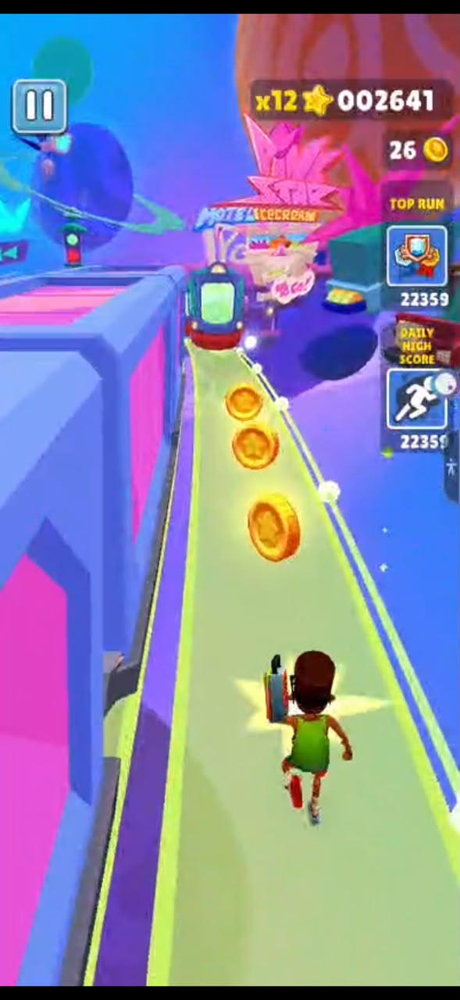
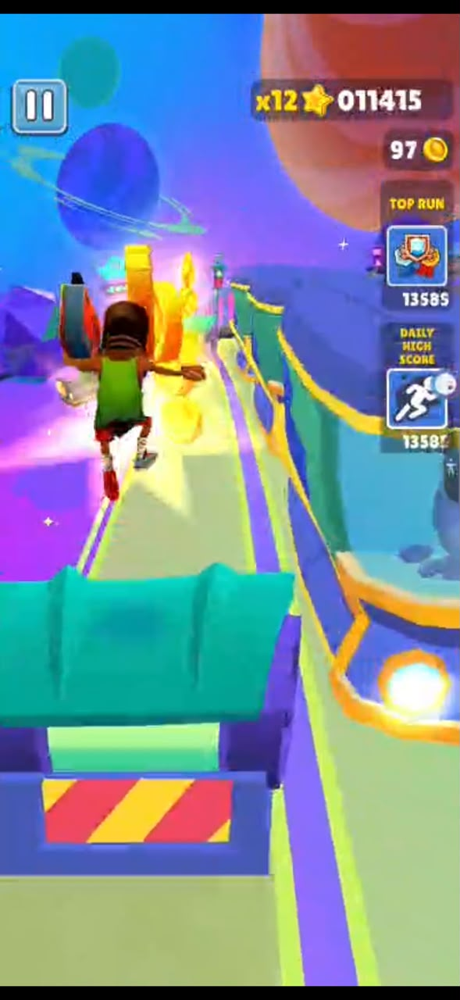
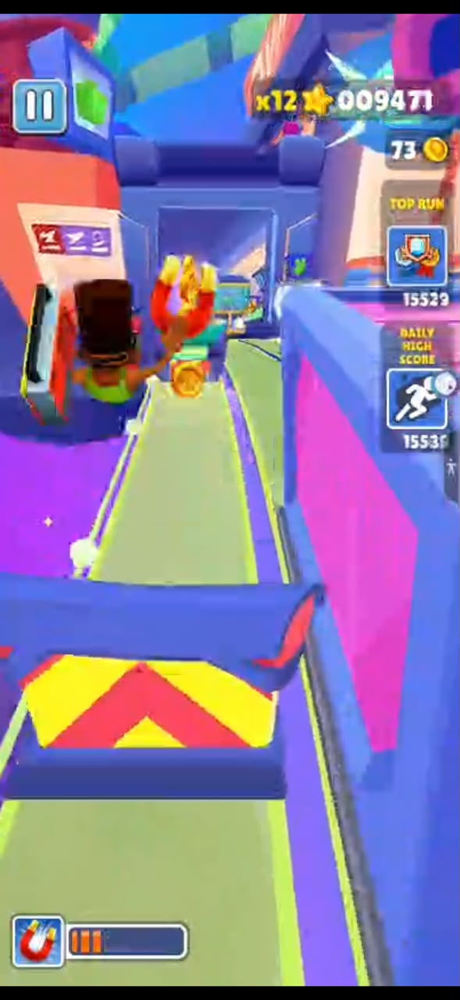
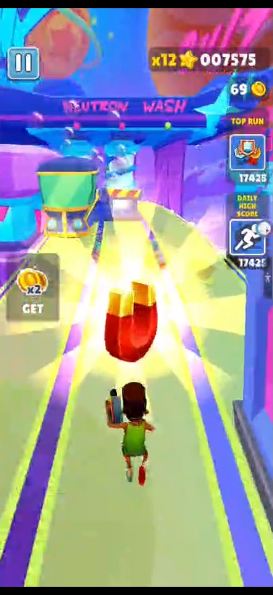

1. M1, M4, M7 · Running down my lane towards a line of coins, with the score, the x12 multiplier and the coin count at the top.
2. M2, M3 · Jumping over a barrier while a train comes past in the lane next to me.
3. M3, M5 · Jumping a barrier with the Coin Magnet on. Its timer bar is at the bottom left.
4. M5 · A Coin Magnet power-up lying on the track, with the 2X coins offer on the left.

| # | Mechanic | Dynamic | Aesthetic | Bartle type |
|---|---|---|---|---|
| M1 | The character runs forward automatically, so the player controls movement rather than stopping to walk. | Players continuously make quick movement decisions because the character keeps moving forward and the environment approaches without stopping. | Sensation: the constant speed and the world rushing at you is exciting on its own, and you have to react quickly to obstacles. | Achiever: the player is trying to survive and improve within the game's rules. |
| M2 | The player can swipe left or right to move between the available lanes. | Players rapidly switch lanes to collect useful items or avoid trains, barriers and other obstacles. | Challenge: choosing the correct lane under time pressure creates an obstacle-solving experience. | Achiever: the player actively changes position to overcome obstacles. |
| M3 | The player can swipe up to jump over obstacles and swipe down to roll under obstacles. | Players choose between jumping, rolling or changing lanes depending on the height and position of an obstacle. | Challenge: the player must read an obstacle and select the correct response quickly. | Achiever: the player's actions directly overcome obstacles in the game world. |
| M4 | Coins can be collected during a run and added to the player's currency total. | Players take calculated risks by moving toward coin paths while still trying to avoid obstacles. | Discovery: players notice and pursue collectible paths and opportunities placed in the running environment. | Explorer: the player looks around the track for the coin lines and the safe way to reach them. |
| M5 | The Coin Magnet collects coins for you, and the 2X Multiplier doubles the coins as you collect them. | Players change their behaviour around power-ups, often moving toward them because the temporary advantage can increase survival, coins or score. | Challenge: temporary abilities help players handle the fast-running obstacle course and improve their performance. | Achiever: the player uses game-system abilities to improve performance and score. |
| M6 | Colliding with an obstacle or train can end the run. | Players become more careful as the run continues and gets faster, and try to predict what to do for obstacles instead of reacting too late. | Challenge: failure is tied to avoiding increasingly difficult obstacles, making successful survival meaningful. | Achiever: the player is trying to beat the game's survival and score conditions. |
| M7 | Players earn score during runs, and longer runs allow them to achieve higher scores and complete objectives. | Players replay runs and attempt safer or more efficient routes to beat previous scores and complete goals. | Challenge: players are motivated to improve their performance against the game's scoring objectives. | Achiever: the main target is measurable performance within the game system. |

**Aesthetic profile:** Challenge and Sensation. Almost every rule (M2, M3, M6, M7) is about reading the next obstacle in time, and a run ends as soon as you get one wrong. The constant speed (M1) is what makes those split-second choices feel exciting rather than just hard.

**Player types**
- Primary: Achiever (acting × world), because I act on the game itself, not on other people. Jumping, rolling and switching lanes (M2, M3) are all about beating its obstacles, and the score and Top Run (M6, M7) are a ladder to climb.
- Secondary: Explorer (interacting × world), because the coin lines and power-ups (M4, M5) reward learning how the track is laid out and where the safe route to the coins is.

## Game 2 · Candy Crush Saga

- **Store link:** https://play.google.com/store/apps/details?id=com.king.candycrushsaga
- **Genre:** Puzzle / Match-3 / Casual / Single player
- **I played:** More than 30 minutes, past the tutorial and through the early levels on the map.
- **Video (optional):** None

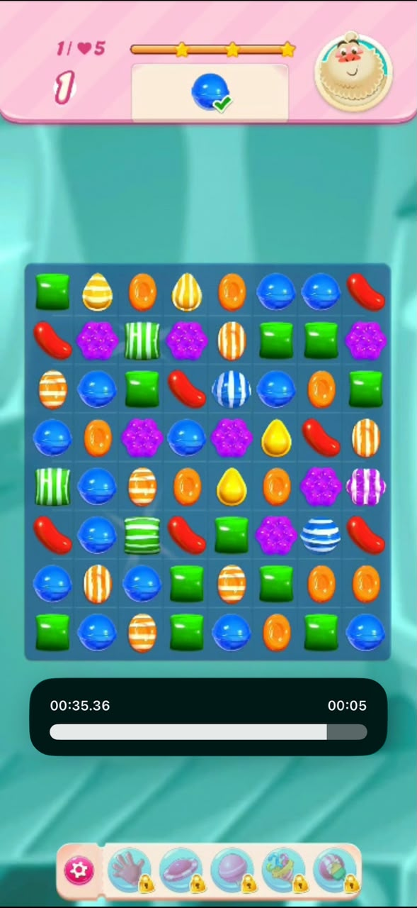
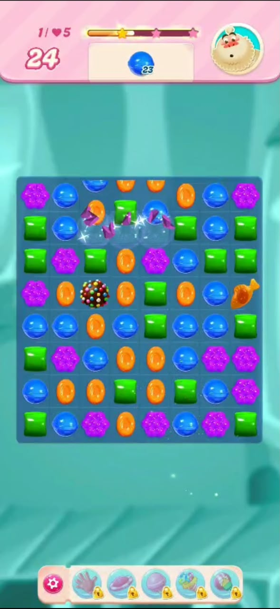
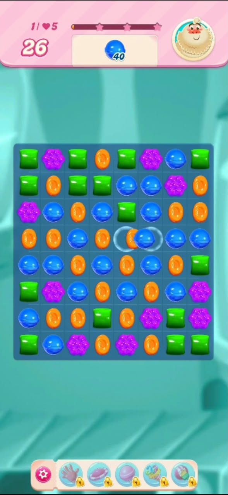
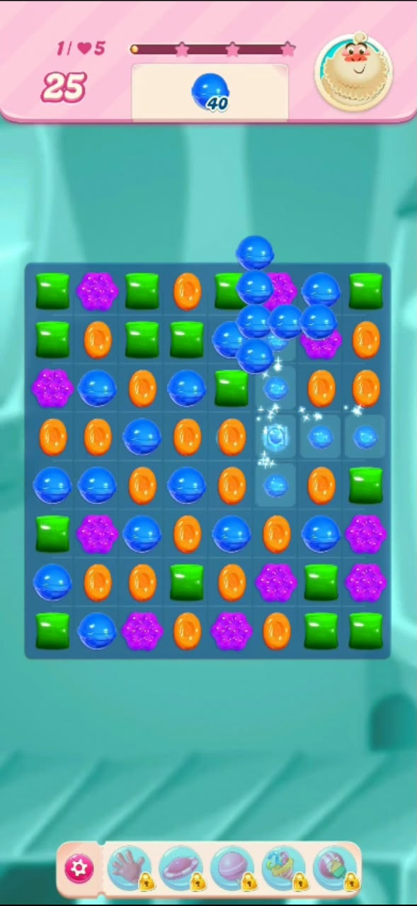

1. M3, M4, M5 · The blue candy order is ticked off with 1 move left, and there are striped candies on the board.
2. M2, M3 · A match clearing while candies fall in. A colour bomb and a fish special candy are on the board, with 24 moves left and 23 blue candies to go.
3. M1, M5 · Swapping an orange candy and a blue candy, with 26 moves left and 40 blue candies to collect.
4. M1, M2, M6 · A line of blue candies being cleared and new ones falling down. The booster bar is along the bottom.

| # | Mechanic | Dynamic | Aesthetic | Bartle type |
|---|---|---|---|---|
| M1 | The player swaps adjacent candies to create a row or column of three or more matching candies. | Players examine the board, search for useful matches, and choose swaps that clear candies while working toward the level objective. | Challenge: players must think ahead and choose effective moves rather than making random swaps. | Achiever: the player acts on the puzzle board to satisfy its rules and objectives. |
| M2 | A successful match removes candies and causes other candies to fall into the empty spaces. | Players look for moves that create follow-up matches and use the resulting cascades to clear more of the board. | Sensation: chain reactions provide immediate visual and audio feedback and make successful moves satisfying. | Explorer: players learn how the board's rules work and use them to produce useful results. |
| M3 | Matching four or more candies can create special candies with stronger clearing effects. | Players deliberately set up larger matches instead of only making basic three-candy matches. | Challenge: players plan their moves to create stronger combinations and solve difficult boards. | Explorer: finding out which shapes make which special candy rewards skilful manipulation of the game system. |
| M4 | Levels have specific objectives, such as achieving required conditions before the move limit is reached. | Players prioritise moves according to the current objective instead of simply clearing any available candies. | Challenge: each objective gives the player a clear puzzle problem to solve within constraints. | Achiever: players work toward measurable level goals. |
| M5 | Many levels give the player a limited number of moves, so each swap reduces the remaining move count. | Players think more carefully about future moves and try to avoid wasting moves on low-value matches. | Challenge: the move limit adds pressure and makes efficient planning important. | Achiever: players optimise actions to complete the level under its rules. |
| M6 | Boosters and special tools can provide additional ways to clear candies or help solve difficult situations. | Players save or use helpful tools when a board becomes difficult, especially when a booster can make the difference between success and failure. | Expression: choosing when and how to use a limited tool gives players some control over their solving approach. | Achiever: a booster used at the right moment turns a lost board into a passed level. |
| M7 | Completing a level advances the player along a larger level progression, with new levels and more complex challenges becoming available. | Players continue attempting levels, retrying failed puzzles, and progressing through the map to reach later challenges. | Submission: the short, self-contained levels make the game suitable for repeated casual sessions and spare-time play. | Achiever: progress through increasingly difficult levels is a central long-term goal. |

**Aesthetic profile:** Challenge, Sensation and Submission. Every level is a puzzle with an objective and a move limit (M1, M4, M5), the cascades (M2) make good moves feel satisfying, and the short levels on a map (M7) make it easy to play a few in spare time and keep coming back.

**Player types**
- Primary: Achiever (acting × world), because I play against the game's rules on my own, with no other players involved. Meeting each level's objective inside the move limit and moving further along the map (M4, M5, M7) is the main goal.
- Secondary: Explorer (interacting × world), because working out how cascades and special candies come about (M2, M3) is a big part of getting better at the game.

## Level blockouts

| Level | Screenshot | Its idea | Wayfinding tool |
|---|---|---|---|
| Level01 | 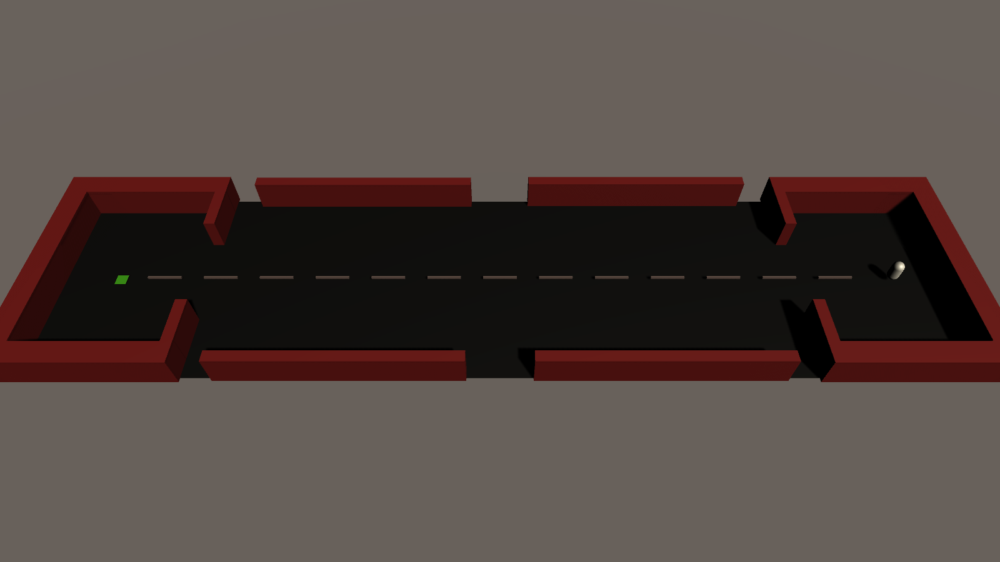 | A spawn room, a long hall and a goal room, about 69 m from spawn to goal. It is the basic layout the other levels change. | Leading lines: a dashed line on the floor runs from the spawn straight to the green goal. |
| Level02 | 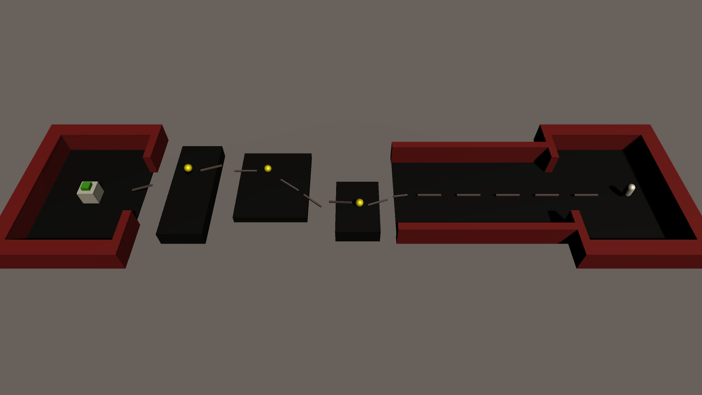 | The hall floor is gone, so you get across on separate platforms at different heights, with gaps between them and a coin on each one. The goal sits on a block at the end. | Leading lines: the lines bend from one platform to the next and show which way to jump. |
| Level03 | 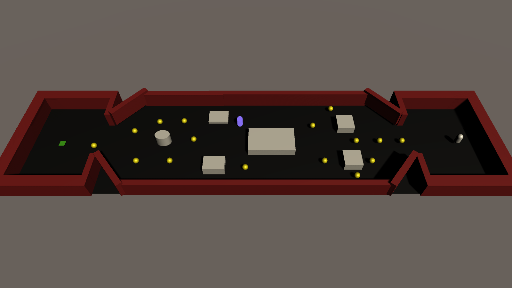 | A split route. A big block sits in the middle of the hall, so you pick the left or the right side and go round the smaller blocks. Diagonal walls pinch you into the goal room. | Breadcrumbs: a trail of coins on both sides of the split leads to the goal. |
